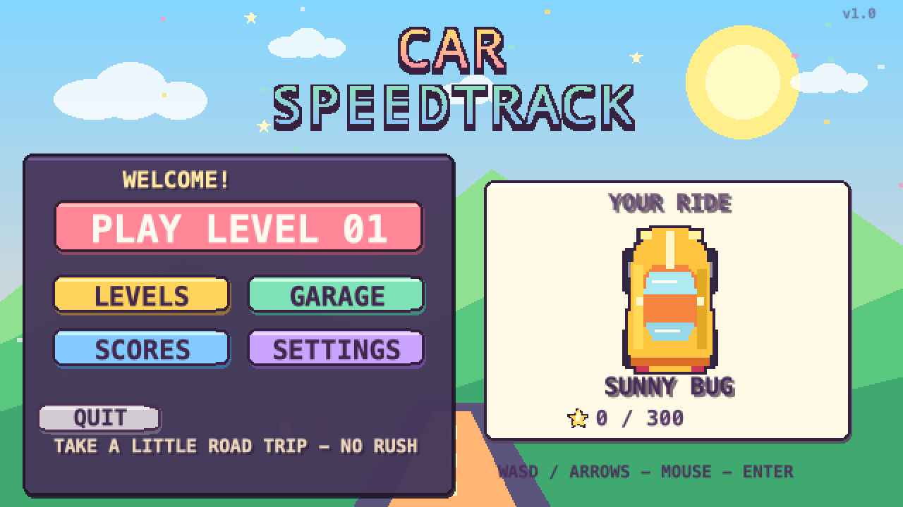
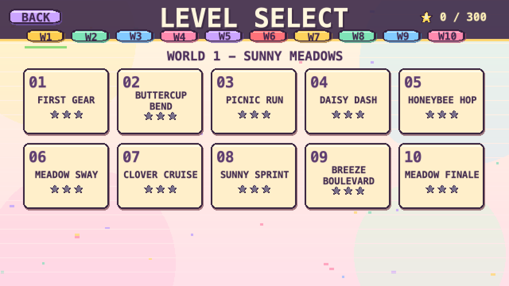
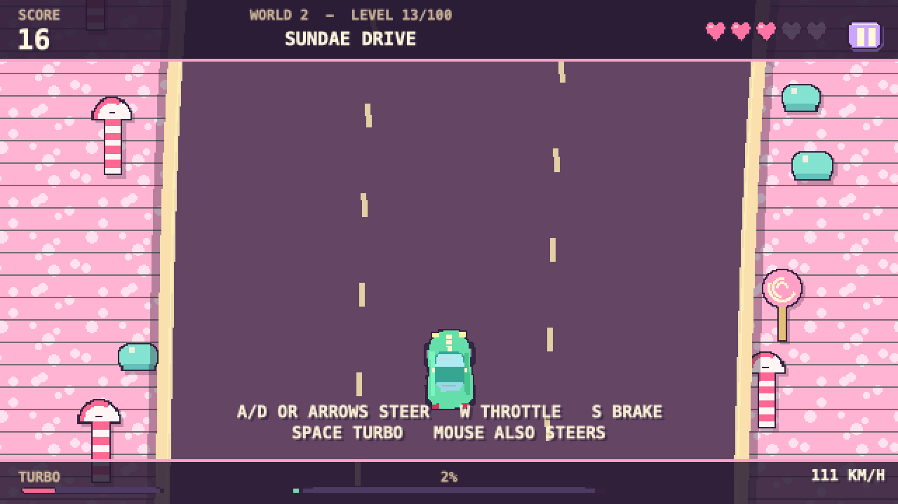
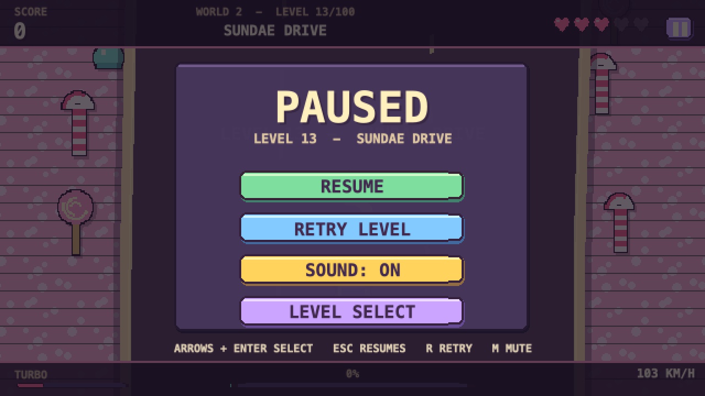
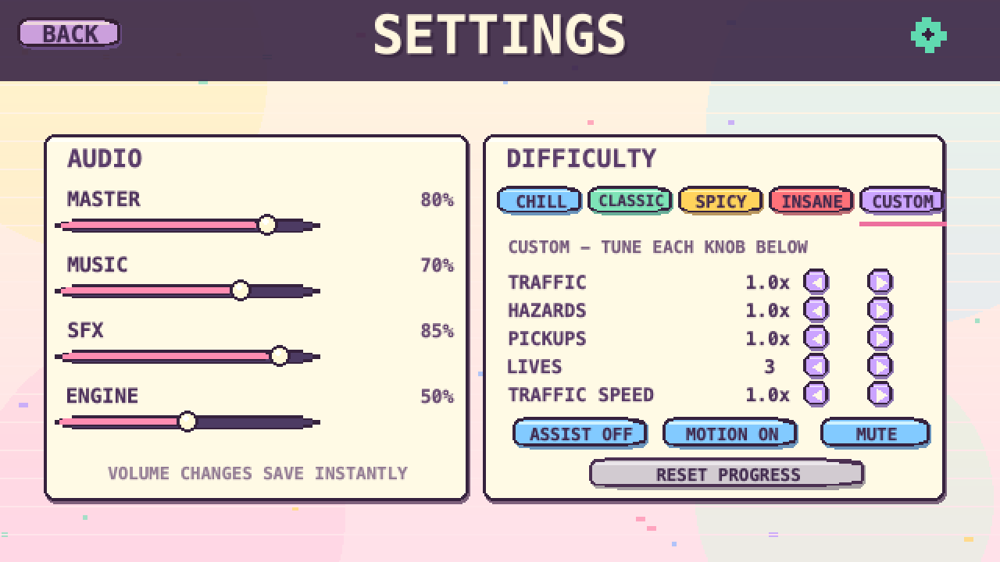
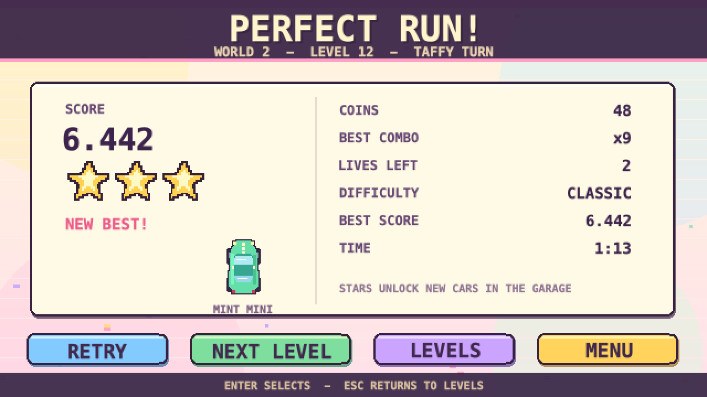

# CarSpeedtrack

A colourful, top-down pixel-art arcade road trip for macOS, written in
**Objective-C** with **SpriteKit** and **AppKit**.

Drive a cheerful little car along procedurally generated roads, dodge friendly
traffic and hazards, collect coins and power-ups, chase a high score, and race
all 100 levels across 10 themed worlds. Every sprite, glyph, music loop, sound
effect, level, and car in the game is generated by the scripts in `Tools/`; no
external art or audio is used.

## Highlights

- **100 hand-tuned levels** across 10 worlds, from Sunny Meadows to the Aurora Finale.
  All levels are available from the level select; the Play button recommends your
  next uncompleted level.
- **8 selectable cars** with distinct sprites, stats, handling, and star-based unlocks.
- **Procedural roads** driven by deterministic level seeds, with baked road chunks.
- **Traps and rewards**: cones, potholes, slicks, traffic, beach balls, tumbleweeds,
  asteroids, snowballs, embers, coins, gems, hearts, shields, magnets, and stars.
- **Lives, combos, boost, near misses, star ratings, and local high scores.**
- **Four difficulty presets plus custom tuning** for lives, traffic, hazards,
  pickups, traffic speed, and steering assist.
- **Keyboard and mouse controls**, pause/retry, fullscreen, window resizing, and
  focus-safe input handling.
- **Generated chiptune soundtrack** (13 loops) and 22 SFX/engine loops.
- **Atomic local save** for progress, settings, car selection, and top-10 scores.

## Screens

| | |
|---|---|
|  |  |
|  |  |
|  |  |

## Requirements

- macOS 13.0 or newer.
- Xcode with the macOS SDK (the project was built and tested with Xcode 27.2).
- XcodeGen 2.46+ only if you want to regenerate the Xcode project from
  `project.yml`. The checked-in `CarSpeedtrack.xcodeproj` opens and builds
  without XcodeGen.
- Python 3 with Pillow and numpy only for regenerating assets.

## Open and run in Xcode

1. Open `CarSpeedtrack.xcodeproj` in Xcode.
2. Select the **CarSpeedtrack** scheme and the **My Mac** destination.
3. Press **Run** (Command-R).

The app launches in a 1280x720 window and can be resized or taken fullscreen.
The game renders at a crisp 640x360 internal resolution with nearest-neighbour
filtering.

## Build and test from the terminal

```bash
make build     # generate the project, build Debug app into build/
make run       # build, then open the app
make test      # run the XCTest suite
make check     # validate assets, build, and run all tests
make assets    # regenerate art, levels, icon, music, and validate
make project   # regenerate CarSpeedtrack.xcodeproj with XcodeGen
```

The raw build command is:

```bash
xcodebuild -project CarSpeedtrack.xcodeproj -scheme CarSpeedtrack \
  -configuration Debug -derivedDataPath build CODE_SIGNING_ALLOWED=NO build
```

The built app is at:

```text
build/Build/Products/Debug/CarSpeedtrack.app
```

## Controls

| Action | Keyboard | Mouse |
|---|---|---|
| Steer | `A` / `D` or `Left` / `Right` | Move the pointer horizontally |
| Throttle | `W` or `Up` | Hold the left mouse button |
| Brake | `S` or `Down` | Hold the right mouse button |
| Boost | `Space` when the turbo meter is full | Use the on-screen turbo meter |
| Pause / resume | `Esc` or `P` | Pause button in the HUD |
| Retry (paused) | `R` | Pause menu |
| Mute | `M` | Pause menu or Settings |
| Menus | Arrows / Tab, Enter / Space, Esc | Hover and click |

Mouse steering re-engages when you move the pointer. Keyboard steering takes
priority while a steering key is held. Losing window focus automatically pauses
a running race and clears held inputs.

## Game flow

`Main Menu -> Level Select / Garage / Scores / Settings -> Briefing -> Race
(countdown, running, paused, finish or failure) -> Results -> Retry / Next Level
/ Levels / Menu`

- Finishing a level unlocks the next one and awards 1-3 stars based on score.
- Stars unlock cars in the Garage.
- Settings and car selection are saved immediately.
- Scores are stored locally in
  `~/Library/Application Support/CarSpeedtrack/save.json`.

## Project layout

```text
project.yml                     XcodeGen project definition
CarSpeedtrack.xcodeproj         checked-in, ready-to-open Xcode project
Makefile                        assets / project / build / test / run / check
CarSpeedtrack/
  App/                          AppKit lifecycle, window, menus, SKView, controller
  Core/                         catalogs, save data, difficulty, road, simulation
  Game/                         SpriteKit gameplay scene, HUD, effects, input
  UI/                           runtime pixel labels, buttons, panels, all screens
  Audio/                        AVAudioPlayer-based music/SFX/engine manager
  Resources/
    Art/                        generated PNGs, glyphs, manifest, logo
    Audio/Music/                generated chiptune loops
    Audio/SFX/                  generated effects and engine loops
    Data/                       levels.json, cars.json, font.json, audio manifest
CarSpeedtrackTests/             XCTest coverage for catalog, road, session, save, assets
Tools/                          deterministic Python asset and level generators
```

### Generated assets and button labels

UI button plates are intentionally blank 9-slice textures. The visible labels
are rendered at runtime by `CSPixelLabelNode` from the generated
`Resources/Art/glyph_*.png` files and `Resources/Data/font.json`. This keeps text
crisp at any window scale. If buttons ever appear blank after changing or
cleaning resources, regenerate the font art and rebuild:

```bash
python3 -m pip install -r Tools/requirements.txt
make assets
make build
```

The asset validator checks that every printable ASCII glyph exists and is
non-empty, so a missing font atlas fails `make check` before it reaches the app.

## Regenerating assets

```bash
python3 -m pip install -r Tools/requirements.txt
make assets
```

Individual generators:

```bash
python3 Tools/generate_art.py          # sprites, UI, glyphs, logo, contact sheet
python3 Tools/generate_levels.py       # 100 levels, 10 worlds, 8 cars
python3 Tools/generate_app_icon.py     # macOS app icon set
python3 Tools/generate_music.py        # 13 music loops + SFX + engine loops
python3 Tools/validate_assets.py       # cross-check every manifest and file
```

`Tools/generate_art.py` also writes `build/art_contact_sheet.png` and
`build/font_preview.png` for quick visual review.

## Tests

The XCTest target covers:

- 100-level catalog integrity, 10 worlds, 8 cars, star unlocks, difficulty presets.
- Deterministic road geometry, bounds, lane ordering, and beyond-finish safety.
- Fixed-step session startup, replay determinism, completion/failure termination.
- Save round-trips, corrupt-save quarantine, score trimming, reset behavior.
- Art/audio manifest coverage and font metrics.

`make check` runs asset validation, a Debug build, and the full test suite
(22 XCTests at the time of writing).

## Developer QA launch arguments

The app accepts these optional arguments when launched directly from the
terminal. They are intended for development and screenshot testing.

| Argument | Purpose |
|---|---|
| `--debug` | Enable debug launch handling. |
| `--no-save` | Use a temporary save and unlock everything. |
| `--scene <name>` | Start in `menu`, `levels`, `briefing`, `garage`, `scores`, `settings`, `game`, `pause`, `gamefinish`, `gameover`, `results`, or `results-fail`. |
| `--level <1-100>` | Choose the level used by scene/debug starts. |
| `--scores-global` | Open the scores screen on the `BEST RUNS` tab. |
| `--car <car-id>` | Override the selected car, for example `sunny-bug`. |
| `--difficulty <preset>` | `chill`, `classic`, `spicy`, `insane`, or `custom`. |
| `--unlock-all` | Treat all levels and cars as unlocked. |
| `--skip-countdown` | Start driving immediately. |
| `--show-fps` | Show SpriteKit FPS and node count. |
| `--mute` | Start muted. |
| `--reduce-motion` | Disable shake, bobbing, and other motion effects. |
| `--snapshot <path>` | Write an in-app PNG snapshot after the scene appears. |
| `--snapshot-delay <seconds>` | Wait before taking the snapshot (default 0.9). |

Example:

```bash
build/Build/Products/Debug/CarSpeedtrack.app/Contents/MacOS/CarSpeedtrack \
  --debug --no-save --unlock-all --scene levels \
  --reduce-motion --snapshot build/levels.png --snapshot-delay 0.9
```

## Save data

The game writes a single versioned JSON file with atomic replacement and a
backup copy:

```text
~/Library/Application Support/CarSpeedtrack/save.json
```

A fresh save starts at **Level 1** with the greeting **WELCOME!**, and all 100
levels are available in the level select. Finishing a level writes completion,
stars, and best score immediately, before the results screen appears, so
progress survives quitting the game.

Corrupt saves are preserved as `save.corrupt-<timestamp>.json`, and the game
continues with safe defaults. Use **Settings -> Reset Progress** to clear the
campaign while keeping audio and display settings.

## Credits

Design, code, generated pixel art, level data, and chiptune audio are all part
of this project. The game uses only Apple system frameworks (AppKit, SpriteKit,
AVFoundation) at runtime and has no network or third-party runtime dependencies.
